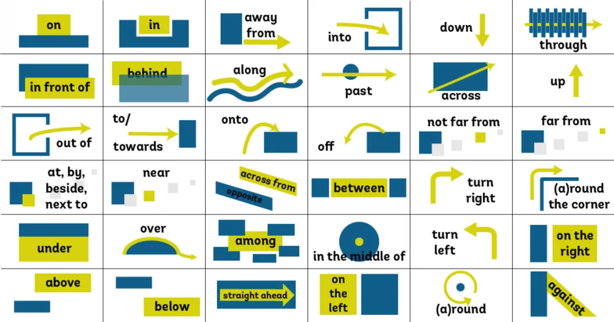

# 介词

介词用在名词、代词或动名词前，表示它们与句中其他成分的关系。

## 用法总览

横向看一个介词的各种用途，纵向比较同一用途下的不同介词。

| 介词 | 时间 | 地点 | 方位 | 方式 | 活动、事件 | 交通工具 |
| --- | --- | --- | --- | --- | --- | --- |
| at | 具体的时刻、节日，如 at 7 o'clock、at night、at the weekend、at Christmas（整个节日期间） | 某个具体的位置（点），如 at the bus stop |  |  | 表示某人参加某个活动或事件，如 at a party |  |
| on | 具体的某一天、日期，如 on Monday、on Christmas Day（节日当天） | 在表面上，如楼层 on the second floor | 两地接壤，如 on the north of China | 电子产品，如 on the TV / radio / internet / screen |  | bus, train, plane, ship，并与 get on/off 搭配 |
| in | 1. 一段时间，如年、月、季节、in the morning / afternoon / evening 2. 后跟一段时间，表示在多久之后，用于将来时 | 大地点，如城市、国家 in Beijing | 在某范围内部，如 in the north of China | 1. 使用某种语言 2. in bed |  | car, taxi，并与 get in / get out of 搭配 |
| to |  |  | 两地不接壤，有间隔，如 to the east of China |  |  |  |
| by | 不晚于某个时间，如 by Friday |  |  |  |  | 以什么方式乘坐交通工具，如 by bus |
| after | 后跟具体的时刻或从句，表示在什么时刻之后，用一般时态，如 after school |  |  |  |  |  |
| since | 后跟具体时刻或从句，表示自从什么时候起一直到现在，常与现在完成时连用，如 since 2020 |  |  |  |  |  |
| for | 后跟一段时间，表示总共有多长之久，如 for two hours |  |  |  |  |  |
| with |  |  |  | 使用某种工具或方法，如 with a pen |  |  |

表示方位时，in、on、to 的区别：

| 表达 | 含义 | 示例 |
| --- | --- | --- |
| in the east of | 在某范围 **内部** 的东部 | Shanghai is in the east of China. |
| on the east of | 在外部，与之 **接壤** | Mongolia is on the north of China. |
| to the east of | 在外部，**不接壤** | Japan is to the east of China. |

on the east of 的说法主要见于国内教材，英语母语者实际上多用 to the east of 同时表示接壤和不接壤两种情况。

时间短语中含有 last、next、this、every 时，不用介词：I saw him last week.（不说 in last week）

## 方位与空间

| 介词 | 含义 | 示例 |
| --- | --- | --- |
| in | 在……里面 | There are some birds in the tree. |
| on | 在……上面（紧贴表面） | There are some apples on the tree. |
| at | 在某处（具体的位置） | at the corner of the street |
| over | 1. 覆盖 2. 在……正上方 3. 越过上空 | The mother put a blanket over the child. the bridge over the river The plane flew over the mountain. |
| above | 在……上面（不接触，不一定是正上方） | the sky above us |
| under | 在……正下方，或接触、被覆盖 | under the table |
| below | 在……下方（above 的反义词，不一定是正下方）；也用于温度 | below zero |
| beneath | 在……之下，多用于抽象概念，如能力、地位低于期望 | beneath contempt |
| near | 在……附近 | near the station |
| by / beside | 在……旁边 | by the window |
| next to | 紧挨着 | next to me |
| across | 从表面横穿，从一边到另一边，如马路、河流、围墙 | go across the street, swim across the river |
| through | 从内部穿过，如公园、大厦、森林、人群、门 | go through the tunnel, walk through the forest |
| past | 经过，路过 | walk past the shop |
| among | 在三者或更多之间 | among the students |
| along | 沿着，顺着 | walk along the river |
| off | 离开（某表面）；离……有一定距离 | get off the bus |

- over 与 above 相比，可以描述动态的“上方”，如飞过。
- in 表示在……里面（静态），into 表示进入……里面（动态）。
- 成对的介词：on / over ↔ under、above ↔ below、into ↔ out of、onto ↔ off、up ↔ down。
- in front of 表示在某物范围外的前面，in the front of 表示在某物范围内的前面。

## 其他易混介词

| 介词 | 区别 |
| --- | --- |
| on time / in time | on time 表示准时；in time 表示及时 |
| for | 表原因：因为……，由于……，如 Thank you for your help. |

## 常用介词详解

### at

1. 具体的时间：at 6am、at midnight / dawn / sunrise / sunset、at the beginning / end of the meeting、at the same time、at the age of ten
2. 具体的地点：at the office、at the village、at the airport
3. at 后接所有格，表示某人的住处或某个店铺：at his uncle's（在他叔叔家）、at the grocer's（在食品杂货店）
4. 无法按面积或空间划分范围的位置：at the bus stop、at the door、at the window、at the foot of the hill
5. 会议、宴会、婚礼等场合：at the meeting、at the wedding、at the press conference
6. 价格、速度、距离等数值：at a high price、at 60 km/h、at a distance、at sea level
7. 与动词连用，表示动作的目标：
    - 看：look at、glance at、stare at
    - 瞄准、攻击：aim at、point at、fire at、shoot at、rush at、jump at、fly at、throw questions at sb.
    - 言语：laugh at、shout at、get at sb.（指责某人）、talk at sb.（指桑骂槐）
    - 敲打、拉拽：knock at the door、pull at the rope
    - 评估：estimate / rate / value … at …（把……估计/评价为……）、guess at（猜测）
    - 抓住：grasp at、catch at a chance
    - 钻研、理解：work at（下功夫）、get at the meaning（理解意思）
8. 表示心情：be shocked / disappointed / surprised / glad / pleased / delighted / sad / angry at …
9. 与形容词最高级连用（可省略 the），表示极限：at (the) most / least、at best / worst、at earliest / latest
10. 固定短语，需结合上下文理解：at large（逍遥法外；总的来说）、at length（最终；详细地）、at heart（内心里，实际上）、be good / bad at（擅长 / 不擅长）、at any cost（不惜任何代价）

### on

1. 在……上、在某人身上、朝向……
    - have … on sb.：让某人（通常是执法部门或权力机构）去对付某人，如 If you show up again, I will have the police on you.
    - on me：我请客，如 Have another cup of coffee on me.
2. 与动词连用，表示上车、上船、上台、上场、上演；乘坐私人汽车则用 get in / into
3. 与动词连用，表示集中在……上，如 focus on
4. 与线状的名词连用，表示相邻、接壤，如 a town on the river
5. 与具体某一天连用，如 on Monday

upon 的用法与 on 相同，但比 on 正式，多用于正式文体中。

### in

1. 地点、空间、范围、方位
2. 涉及人体部位时：表面多用 on，打击较软或中空的部位用 in，如 hit him in the stomach
3. 疼痛和创伤所在的部位，通常用 in，如 a pain in the back
4. 一段时间，如年、月、季节、in the morning、in the 1980s
5. 衣着、特征、性质、情绪、心境、从事的职业等，如 in red、in a hurry

### to

1. 到、朝向
2. 达到某数字、金额、温度等

### by

1. 在……旁
2. 通过、经由、取道
3. 表示截止时间，不晚于……
4. 在被动语态中引出动作的执行者
